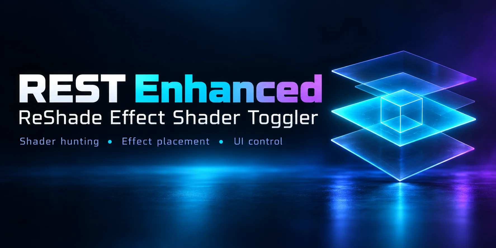

# REST Enhanced

**ReShade effects where you want them. A clear view when you need it.**

Shader hunting, precise effect placement and UI control for ReShade and photomode workflows.

Maintained by **[Pav-Osmolski / DeViLhoOD](https://github.com/Pav-Osmolski)**.

[Website](https://pav-osmolski.github.io/ReshadeEffectShaderToggler/) · [Download](https://github.com/Pav-Osmolski/ReshadeEffectShaderToggler/releases) · [Documentation](docs/README.md) · [Changelog](CHANGELOG.md) · [Report an issue](https://github.com/Pav-Osmolski/ReshadeEffectShaderToggler/issues/new/choose)

REST Enhanced lets you find game shaders, group them and apply selected ReShade effects at a suitable point in the frame. Keep effects beneath later UI or fog, hide interface elements for screenshots, and work with upscaled rendering using Automatic Scene Colour. The available result depends on the game, graphics API and shader boundary you select.

## Choose your download

| Your ReShade installation | REST release | Game architecture |
|---|---|---|
| ReShade 6.8+ with full add-on support | **Modern** — [Latest release](https://github.com/Pav-Osmolski/ReshadeEffectShaderToggler/releases/latest) | `.addon64` for 64-bit games; `.addon32` for 32-bit games |
| ReShade 5.8–5.9.2 with full add-on support | **Legacy / ReShade 5.x** — [Release list](https://github.com/Pav-Osmolski/ReshadeEffectShaderToggler/releases) | Both architectures included; ReShade 5.9.2 recommended |

Future release downloads use **`REST-Enhanced-Modern-v<VERSION>.zip`** and **`REST-Enhanced-Legacy-v<VERSION>.zip`**. Older releases use `release.zip`; choose the asset on the correct release page. GitHub's source-code ZIPs are not compiled add-ons.

## Get started

1. Install ReShade with **full add-on support** against the executable the game actually renders through.
2. Close the game. Back up your REST INI, then copy the matching `.addon64` or `.addon32` beside that executable. Keep one REST build installed.
3. Copy the supplied `Shaders/REST_*.fx` helpers into a configured ReShade effect folder. Make sure `ReShade.fxh` is available through the include path.
4. Open **ReShade → Add-ons → REST Enhanced**, create a group and start hunting. Select a shader boundary for effects, or identify HUD shaders for hiding.
5. Finish hunting, test the group and click **Save changes**.

Follow the [installation guide](docs/getting-started.md) for the complete setup and upgrade steps.

## What would you like to do?

| Goal | Start here |
|---|---|
| Find and mark game shaders | [Shader hunting](docs/shader-hunting.md) |
| Place effects beneath later UI or fog | [Effect placement](docs/effect-placement.md) |
| Hide the HUD for screenshots | [UI hiding and masking](docs/ui-control.md) |
| Use DLSS, dynamic resolution or another upscaler | [Automatic Scene Colour](docs/automatic-scene-colour.md) |
| Set up Enshrouded or Baldur's Gate 3 | [Game guides](docs/game-guides.md) |
| Understand HDR, alpha and previews | [HDR guide](docs/HDR.md) |
| Diagnose missing effects or a crash | [Troubleshooting](docs/troubleshooting.md) |

## Compatibility at a glance

Automatic Scene Colour supports **D3D10, D3D11, D3D12 and Vulkan**. D3D9 supports manual workflows and standalone surface targets; it does not gain Auto Scene Colour or modern HDR presentation. Vulkan requires a compatible image and a safe later pass boundary. See [compatibility and limitations](docs/compatibility.md).

REST chooses where an effect runs; it does not make SDR effects HDR-aware or guarantee a suitable boundary in every game. The optional **Vulkan scene transfers** setting defaults off and requires saving and restarting. See the [saved-setting guide](docs/vulkan-scene-transfer-setting.md).

## Project

- [Build REST](docs/BUILDING.md) · [Release and packaging process](docs/RELEASING.md)
- [Credits and upstream work](docs/credits.md) · [Validation records](docs/validation.md)
- [Licence](LICENSE) · [Fork licence notice](docs/fork-license.txt)

Built on the work of alex / 4lex4nder, Frans Bouma and the ReShade community. Full contributor acknowledgements are in [Credits](docs/credits.md).
